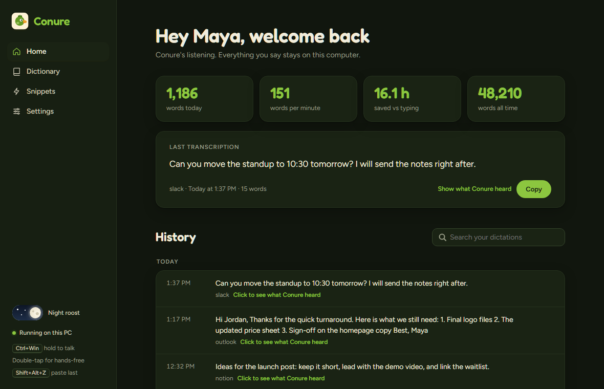

<p align="center"></p>

<h1 align="center">Conure</h1>

<p align="center">Private, offline voice dictation for Windows.<br>
Hold a shortcut, talk, let go. Clean text appears wherever your cursor is.</p>

<p align="center"></p>

Everything runs on your PC. The speech model, the cleanup model and your history never leave it.

## What it does

Hold `Ctrl` + `Win`, say what you want to write, and let go. Conure transcribes it, tidies it up and pastes it into whatever you're using, whether that's an email, a chat, a document, a code editor or an AI prompt box.

The cleanup is light. It drops the ums and false starts, understands "scratch that" and "never mind", fixes punctuation, and turns counting out loud ("one, ... two, ... three") into a numbered list. If you'd rather keep your exact words, press `Ctrl` + `Z` right after it pastes.

It picks up your vocabulary as you go. Correct a word right after it's pasted and Conure remembers it. Correct the same word twice and it starts fixing it for you. Names showing in the window you're typing in, like an email sender or someone in a chat, get spelled the way they appear on screen, and anything else can go in the Dictionary.

A few other things it does:

- Snippets. Say "my booking link" and the saved link gets pasted.
- Command mode. Select some text, hold `Ctrl` + `Win` + `Alt` and say "make this shorter".
- Game mode. While a full-screen game is running, Conure unloads its models and stops watching the keyboard until you switch away.
- A day and a night theme, a small pill above the taskbar while it listens, and a searchable history.

## Requirements

- Windows 10 or 11, 64-bit
- A microphone
- About 4 GB of free disk space
- A graphics card with Vulkan support and about 3 GB of free video memory for the cleanup model. Most AMD, NVIDIA and Intel graphics from the last several years qualify. Without one, Conure still types what you say, with lighter cleanup.

## Install

1. Download this repository: the green **Code** button, then **Download ZIP**. Unzip it anywhere.
2. Double-click **`Setup.bat`**.
3. Setup downloads about 3.5 GB once (Python, the two models and llama.cpp), installs Conure into `%USERPROFILE%\Conure` and starts it. A short welcome tour opens.

Windows may say "Windows protected your PC" because the files aren't signed. Click **More info**, then **Run anyway**.

Running `Setup.bat` again is safe. It skips anything that's already downloaded, so it's also the way to finish an interrupted install.

## How to use it

| Shortcut | What it does |
|---|---|
| Hold `Ctrl` + `Win` | Talk while holding, release to paste |
| Double-tap `Ctrl` + `Win` | Hands-free: keeps listening until you tap again |
| Hold `Ctrl` + `Win` + `Alt` | Command mode: say what to do with the selected text |
| `Esc` | Cancel while recording |
| `Shift` + `Alt` + `Z` / `X` | Paste / copy your last dictation |
| `Win` + `Alt` + `1` / `2` | Polish the selected text / run your own polish prompt |
| `Ctrl` + `Z` right after a paste | Swap the cleaned text for your exact words |

All shortcuts can be changed in **Settings**. You can also press and hold the pill to talk, or click it to open the dashboard. Conure lives in the tray next to the clock.

## Privacy

- Conure runs entirely on your PC. The only time it uses the internet is during setup, to download the models.
- It watches the keyboard for its own shortcuts. While you dictate, it reads the text around your cursor and the names on screen in the window you're typing in, only to spell things right. That text is never saved.
- The microphone stays open while Conure runs, so your first word is never cut off, and Windows shows its microphone icon. Audio is only kept while you hold the shortcut, and it is never written to disk.
- Your history, settings and learned words are stored in `%USERPROFILE%\Conure\data` and nowhere else. You can delete single entries from the history, back everything up to a file from **Settings**, or delete the folder.

## Uninstall

1. Right-click the parrot in the tray and choose **Quit Conure**.
2. Delete the folder `%USERPROFILE%\Conure`.
3. Delete the Conure shortcuts from the Start menu, the Desktop and the Startup folder (type `shell:startup` in the Run box to open it).
4. Optional: the speech model is cached in `%USERPROFILE%\.cache\huggingface`. If setup installed uv for you, `uv self uninstall` removes it.

## Troubleshooting

- **Nothing happens when I hold the shortcut.** Check that the parrot is in the tray. If its tooltip says it's asleep, Game mode thinks a full-screen app is running, or it was paused from the tray menu.
- **Text is pasted but not cleaned up.** The cleanup model couldn't start on your graphics card. `%USERPROFILE%\Conure\data\llm.log` says why.
- **Another app reacts to the same shortcut.** Pick a different one in **Settings > Shortcuts**.
- **Wrong microphone.** Choose yours in **Settings > Microphone**.

## For developers

Conure is two files: `dictate.py` (the app) and `dashboard.html` (the dashboard window).

```bat
:: run from this folder with a console showing the log
start.bat

:: check the text and shortcut logic
%USERPROFILE%\Conure\venv\Scripts\python.exe dictate.py --selftest

:: copy your changes into the installed app
%USERPROFILE%\Conure\venv\Scripts\python.exe dictate.py --install
```

## License

MIT, see [`LICENSE`](LICENSE). Conure builds on NVIDIA Parakeet, Qwen3, llama.cpp and other open-source projects, listed with their licenses in [`THIRD_PARTY_NOTICES.md`](THIRD_PARTY_NOTICES.md).
